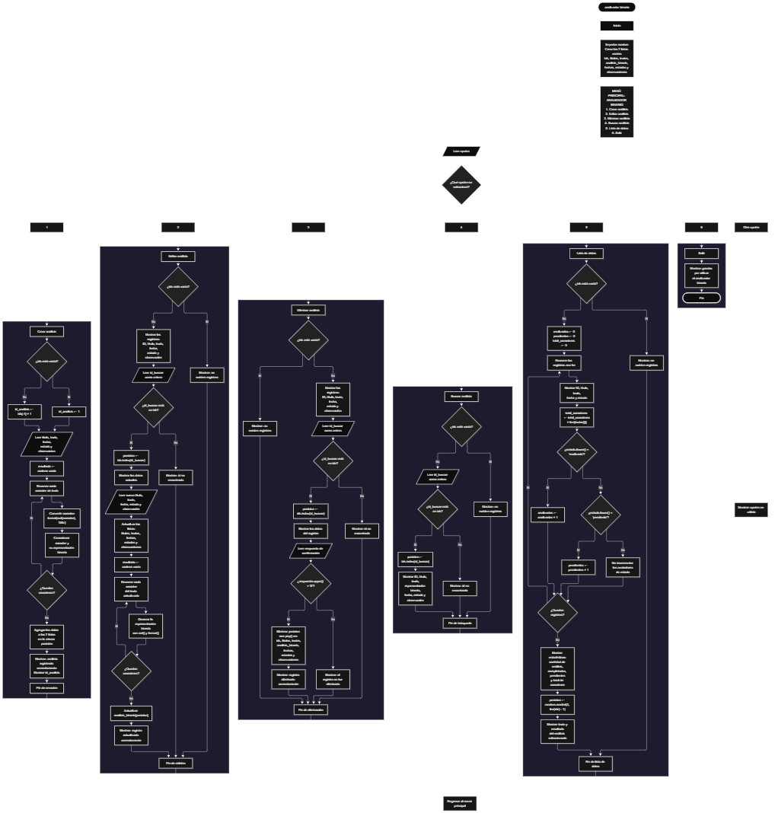

 

Este proyecto, llamado <b>analizador binario</b>, fue desarrollado en <b>python</b> como un ejercicio práctico para fortalecer la lógica de programación mediante la creación de un sistema de gestión y conversión de textos a representaciones binarias desde la consola. El programa cuenta con un menú principal de seis opciones que permite <b>crear, editar, eliminar, buscar y listar análisis</b>, además de finalizar la ejecución. Cada análisis almacena información como el título, el texto, la representación binaria de sus caracteres, la fecha, el estado y las observaciones. Los registros se organizan mediante siete listas relacionadas que permiten mantener los datos correspondientes a cada análisis en la misma posición. Durante su desarrollo se aplicaron conceptos fundamentales de programación, como variables, listas, estructuras condicionales, ciclos repetitivos, búsqueda de registros, modificación y eliminación de datos, además del uso de funciones integradas para obtener códigos numéricos de caracteres y representarlos en formato binario. El proyecto también incorpora estadísticas sobre los análisis registrados y una selección aleatoria de un análisis para mostrar su texto y resultado binario. La información se mantiene temporalmente en memoria durante la ejecución del programa.

<h2 align="center">⚙️ Funcionamiento del menú principal</h2>

### ➕ Crear análisis

La opción <b>1) crear análisis</b> permite registrar un nuevo análisis en el sistema. Primero, el programa comprueba si existen registros en la lista <b>ids</b>. Si no hay registros, asigna el identificador inicial <b>1</b>; de lo contrario, genera el siguiente identificador sumando uno al último valor almacenado en la lista mediante la expresión <b>ids[-1] + 1</b>. Después, solicita el <b>título, texto, fecha, estado y observación</b> del análisis. Para generar la representación binaria, recorre cada carácter del texto mediante un ciclo <b>for</b> y utiliza las funciones <b>ord()</b> y <b>format()</b>. La expresión <b>format(ord(caracter), "08b")</b> obtiene el valor numérico del carácter y lo representa en base binaria con un mínimo de ocho dígitos, agregando ceros a la izquierda cuando sea necesario. El resultado se construye mostrando cada carácter junto con su representación binaria. Finalmente, los datos se almacenan en las siete listas correspondientes y el programa presenta el mensaje <b>"análisis registrado correctamente."</b>, seguido del identificador asignado. El estado se solicita como analizado o pendiente, aunque el programa no restringe la entrada a esos dos valores.

### ✏️ Editar análisis

La opción <b>2) editar análisis</b> permite modificar la información de un análisis registrado. Primero, el programa comprueba si la lista <b>ids</b> está vacía. Si no existen registros, muestra el mensaje <b>"no existen registros."</b>. En caso contrario, presenta una lista con el identificador, título, texto, fecha, estado y observación de cada análisis. Después, solicita el identificador del registro que se desea editar y comprueba si se encuentra en la lista <b>ids</b>. Si existe, utiliza el método <b>index()</b> para obtener su posición y muestra los datos actuales. A continuación, solicita el nuevo título, texto, fecha, estado y observación, actualizando los valores de las listas correspondientes. Como el texto puede cambiar, el programa vuelve a generar su representación binaria mediante un ciclo <b>for</b> y actualiza el elemento correspondiente de la lista <b>analisis_binario</b>. Finalmente, muestra el mensaje <b>"registro actualizado correctamente."</b>. Si el identificador no existe, presenta el mensaje <b>"id no encontrada."</b>.

### 🗑️ Eliminar análisis

La opción <b>3) eliminar análisis</b> permite eliminar un registro mediante su identificador. Antes de comenzar, el programa comprueba si existen datos almacenados en la lista <b>ids</b>. Si no hay registros, muestra el mensaje <b>"no existen registros."</b>. Si existen análisis, presenta una lista con sus identificadores, títulos, textos, fechas, estados y observaciones. Después, solicita el identificador del análisis que se desea eliminar y comprueba si se encuentra registrado. Si existe, obtiene su posición mediante <b>index()</b>, muestra los datos del registro y solicita confirmación mediante la pregunta <b>"¿desea eliminar este registro? (s/n):"</b>. Cuando el usuario introduce la letra <b>"s"</b>, el programa la convierte a mayúscula mediante <b>upper()</b> y elimina el elemento de las siete listas utilizando el método <b>pop()</b>. De esta manera, se retiran el identificador, título, texto, representación binaria, fecha, estado y observación correspondientes a la misma posición. Finalmente, presenta el mensaje <b>"registro eliminado correctamente."</b>. Si el usuario no confirma la operación, muestra el mensaje <b>"el registro no fue eliminado."</b>. Si el identificador no existe, informa que no fue encontrado.

### 🔎 Buscar análisis

La opción <b>4) buscar análisis</b> permite localizar un registro mediante su identificador. Primero, el programa comprueba si existen análisis almacenados. Si la lista <b>ids</b> está vacía, presenta el mensaje <b>"no existen registros."</b>. En caso contrario, solicita el identificador que se desea buscar y verifica si está presente en la lista. Cuando encuentra una coincidencia, utiliza <b>index()</b> para determinar la posición del registro y muestra toda su información: <b>identificador, título, texto, representación binaria, fecha, estado y observación</b>. Esta operación permite consultar los datos completos de un análisis sin necesidad de recorrer manualmente todos los registros. Si el identificador introducido no está registrado, el programa muestra el mensaje <b>"id no encontrada."</b>.

### 📋 Lista de datos

La opción <b>5) lista de datos</b> permite visualizar los análisis registrados, consultar estadísticas generales y mostrar un análisis seleccionado aleatoriamente. Primero, el programa comprueba si existen registros en la lista <b>ids</b>. Si no hay datos, muestra el mensaje <b>"no existen registros."</b>. Si existen análisis, inicializa las variables <b>analizados, pendientes y total_caracteres</b> en cero. Después, utiliza un ciclo <b>for</b> para recorrer las listas y mostrar el identificador, título, texto, fecha y estado de cada registro. Durante el recorrido, suma la cantidad de caracteres de cada texto mediante <b>len()</b>. También comprueba el estado de cada análisis utilizando <b>lower()</b>, que permite reconocer los valores <b>"analizado"</b> y <b>"pendiente"</b> sin distinguir entre mayúsculas y minúsculas. Al terminar, presenta la cantidad total de análisis, los análisis completados, los análisis pendientes y el total de caracteres almacenados en los textos. Finalmente, utiliza <b>random.randint(0, len(ids) - 1)</b> para seleccionar una posición aleatoria entre los registros existentes y mostrar el texto seleccionado junto con su representación binaria. Esta opción combina la consulta de información, el cálculo de estadísticas y la selección aleatoria de un análisis.

### 🚪 Salir del menú principal

La opción <b>6) salir</b> permite finalizar la ejecución del programa. Cuando el usuario selecciona esta opción, el sistema muestra el mensaje <b>"gracias por utilizar el analizador binario."</b> y ejecuta la instrucción <b>break</b>, que interrumpe el ciclo <b>while True</b> y termina el menú principal. El programa no solicita confirmación adicional para salir. Los registros se encuentran almacenados en listas de Python, por lo que la información se conserva mientras el programa permanece en ejecución, pero no se guarda automáticamente en archivos ni en una base de datos. Al finalizar la ejecución, los datos almacenados en memoria dejan de estar disponibles.

<h2 align="center">🧠 Temas aplicados en el proyecto</h2>

### 📦 Variables

En este proyecto se utilizan variables para controlar las opciones del menú, generar identificadores, almacenar temporalmente los datos de cada análisis, localizar registros, construir las representaciones binarias y calcular las estadísticas. Cada variable cumple una función específica dentro de las operaciones del sistema y permite organizar el procesamiento de la información.

🔢 **Opcion:** Almacena la opción introducida por el usuario en el menú principal.

🆔 **Id_analisis:** Almacena el identificador que se asigna al crear un nuevo análisis.

📝 **Titulo:** Almacena el título introducido durante el registro de un análisis.

📄 **Texto:** Almacena el texto que se desea convertir a una representación binaria.

📅 **Fecha:** Almacena la fecha proporcionada para el análisis.

📌 **Estado:** Almacena el estado del análisis, como analizado o pendiente.

💬 **Observacion:** Almacena las observaciones asociadas al registro.

🔢 **Resultado:** Construye la representación binaria de los caracteres del texto.

🔎 **Id_buscar:** Almacena el identificador introducido para localizar un registro.

📍 **Posicion:** Indica la posición de un análisis dentro de las listas relacionadas.

🔄 **Caracter:** Representa cada carácter recorrido durante la conversión del texto.

📊 **Analizados:** Cuenta los registros cuyo estado es analizado.

⏳ **Pendientes:** Cuenta los registros cuyo estado es pendiente.

🔠 **Total_caracteres:** Acumula la cantidad de caracteres de los textos registrados.

🎲 **I:** Se utiliza como contador en los ciclos de recorrido de las listas.

🎯 **Respuesta:** Almacena la respuesta del usuario al confirmar la eliminación de un registro.

### 🗃️ Listas

En este proyecto se utilizan siete listas relacionadas para almacenar la información de los análisis. Cada lista cumple una función específica y utiliza la misma posición para representar los datos de un mismo registro. Por ejemplo, el análisis situado en la posición <b>0</b> de la lista <b>ids</b> corresponde al título almacenado en la posición <b>0</b> de <b>titulos</b>, al texto de <b>textos</b> y a los valores correspondientes de las demás listas. Esta organización permite consultar, editar y eliminar la información de manera coordinada. Las listas no tienen una capacidad máxima fija establecida en el código.

🆔 **Ids:** Almacena los identificadores de los análisis registrados.

📝 **Titulos:** Almacena los títulos de los análisis.

📄 **Textos:** Almacena los textos que se convierten a representación binaria.

🔢 **Analisis_binario:** Almacena la representación binaria generada para cada texto.

📅 **Fechas:** Almacena las fechas asociadas a los análisis.

📌 **Estados:** Almacena el estado de cada análisis.

💬 **Observaciones:** Almacena las observaciones de cada registro.

### 🔀 Estructuras condicionales

En este proyecto se utilizan las estructuras condicionales <b>if, elif y else</b> para controlar el funcionamiento del menú principal y las operaciones disponibles. Estas condiciones permiten determinar si existen registros almacenados, comprobar si un identificador está presente en la lista <b>ids</b>, decidir si se actualiza o elimina un análisis y clasificar los registros según su estado. También se utilizan para comprobar si el usuario ha confirmado una eliminación y para mostrar un mensaje cuando introduce una opción que no está contemplada en el menú. Gracias a estas estructuras, el programa ejecuta instrucciones diferentes según los datos disponibles y las decisiones del usuario.

### 🔄 Estructuras repetitivas

El programa utiliza los ciclos <b>while</b> y <b>for</b> para ejecutar las operaciones de forma repetitiva. El ciclo <b>while True</b> mantiene activo el menú principal hasta que el usuario selecciona la opción de salida y se ejecuta <b>break</b>. Los ciclos <b>for</b> permiten recorrer los caracteres de un texto para construir su representación binaria y recorrer las listas para mostrar los registros y calcular las estadísticas. Estas estructuras permiten procesar varios caracteres y administrar múltiples análisis sin repetir manualmente las mismas instrucciones.

### 🎯 Estructura de selección del menú

El menú principal se organiza mediante una estructura condicional formada por <b>if, elif y else</b>. El programa compara el valor almacenado en <b>opcion</b> con las cadenas correspondientes a cada alternativa. La opción <b>"1"</b> permite crear un análisis; <b>"2"</b>, editarlo; <b>"3"</b>, eliminarlo; <b>"4"</b>, buscarlo; <b>"5"</b>, consultar la lista de datos y sus estadísticas; y <b>"6"</b>, salir del programa. Si el valor introducido no coincide con ninguna de estas alternativas, se ejecuta el bloque <b>else</b>, que muestra el mensaje <b>"opción no válida."</b>. Esta estructura organiza las funcionalidades en bloques independientes y facilita la navegación por el sistema.

### 🔢 Conversión de caracteres a binario

La conversión binaria constituye la funcionalidad principal del proyecto. Para realizarla, el programa recorre cada carácter del texto y utiliza la función <b>ord()</b> para obtener su valor numérico según Unicode. Después, aplica <b>format(ord(caracter), "08b")</b> para representar ese valor en base binaria, utilizando al menos ocho dígitos. El resultado se concatena con el carácter original y se almacena en la variable <b>resultado</b>. Por ejemplo, la letra <b>A</b> tiene el valor numérico 65 y su representación binaria es <b>01000001</b>. El formato <b>08b</b> establece un mínimo de ocho posiciones, pero no limita la representación a ocho bits; los caracteres con valores numéricos mayores que 255 pueden generar representaciones más largas. Por ello, el programa trabaja con valores de caracteres Unicode y no exclusivamente con caracteres ASCII.

### 🔍 Búsqueda de registros

Para localizar un análisis, el programa utiliza el operador <b>in</b> para comprobar si el identificador introducido se encuentra en la lista <b>ids</b>. Si existe, emplea el método <b>index()</b> para obtener su posición. Esa posición se utiliza para recuperar los valores relacionados de las listas <b>titulos, textos, analisis_binario, fechas, estados y observaciones</b>. Este procedimiento permite acceder a la información completa de un registro y también se utiliza en las operaciones de edición y eliminación.

### 🧮 Cálculo de estadísticas

Durante la opción de lista de datos, el programa calcula estadísticas mediante variables acumuladoras y contadores. La función <b>len(ids)</b> permite conocer la cantidad total de análisis registrados, mientras que <b>len(textos[i])</b> obtiene la cantidad de caracteres de cada texto. La suma de estas cantidades se almacena en <b>total_caracteres</b>. Además, el método <b>lower()</b> convierte temporalmente el estado a minúsculas para reconocer los valores <b>"analizado"</b> y <b>"pendiente"</b>. Los contadores <b>analizados</b> y <b>pendientes</b> aumentan cuando se encuentra un estado coincidente. Los registros con otros estados no se incluyen en ninguno de esos dos contadores.

### 🎲 Selección aleatoria

El proyecto utiliza el módulo <b>random</b> para seleccionar uno de los análisis registrados de manera aleatoria. La instrucción <b>random.randint(0, len(ids) - 1)</b> genera un número entero que corresponde a una posición válida dentro de las listas, siempre que existan registros. El valor obtenido se almacena en la variable <b>posicion</b> y permite mostrar el texto seleccionado junto con su representación binaria. Esta funcionalidad se ejecuta al elegir la opción de lista de datos y no modifica los registros almacenados.

<h2 align="center">¿Cómo se implementaron las operaciones crud en el proyecto?</h2>

Las operaciones <b>crud</b> se implementaron mediante las opciones del menú principal, permitiendo administrar los análisis registrados. La operación <b>crear</b> corresponde a <b>crear análisis</b>, donde se solicitan los datos y se genera su representación binaria; <b>leer</b> se realiza mediante las opciones <b>buscar análisis y lista de datos</b>, que permiten consultar los registros y sus estadísticas; <b>actualizar</b> corresponde a <b>editar análisis</b>, donde se modifican los datos del registro y se vuelve a generar la representación binaria cuando cambia el texto; y <b>eliminar</b> se realiza mediante la opción <b>eliminar análisis</b>, que solicita confirmación antes de retirar los datos de las siete listas. Estas operaciones se ejecutan sobre listas de Python, por lo que los registros se mantienen únicamente en la memoria del programa durante su ejecución.

<h2 align="center">Diagrama de flujo del proyecto</h2>

<h2 align="center">🛡️ Validaciones del programa</h2>

### 📭 No existen registros

Esta comprobación se utiliza en las opciones de <b>editar, eliminar, buscar y lista de datos</b>. El programa verifica si la lista <b>ids</b> tiene una longitud igual a cero mediante la condición <b>len(ids) == 0</b>. Si no existen análisis registrados, muestra el mensaje <b>"no existen registros."</b> y evita continuar con la operación seleccionada. Esta comprobación permite informar al usuario cuando una función necesita datos que todavía no se han almacenado.

### ❌ Identificador no encontrado

Esta comprobación se utiliza en las opciones de <b>editar, eliminar y buscar análisis</b>. El programa comprueba si el identificador introducido se encuentra en la lista <b>ids</b> mediante la condición <b>id_buscar in ids</b>. Si existe, obtiene su posición y continúa con la operación correspondiente. Si no está registrado, muestra el mensaje <b>"id no encontrada."</b>. Esta condición evita realizar modificaciones, eliminaciones o consultas sobre un identificador que no corresponde a ningún análisis almacenado.

### ⚠️ Confirmación de eliminación

Antes de eliminar un análisis, el programa solicita al usuario una confirmación mediante la variable <b>respuesta</b>. La condición <b>respuesta.upper() == "S"</b> permite aceptar la letra <b>"s"</b> tanto en mayúscula como en minúscula. Si la respuesta coincide, el programa elimina el registro de las siete listas mediante <b>pop()</b>. Si la respuesta es diferente, muestra el mensaje <b>"el registro no fue eliminado."</b> y conserva los datos. El programa no exige específicamente que la respuesta sea "s" o "n"; cualquier otra entrada también cancela la eliminación.

### 🔄 Actualización de la representación binaria

Cuando se edita un análisis, el programa vuelve a generar la representación binaria a partir del texto actualizado. Para ello, recorre los caracteres de <b>textos[posicion]</b> y construye un nuevo resultado mediante <b>ord()</b> y <b>format()</b>. Después, reemplaza el valor correspondiente en <b>analisis_binario[posicion]</b>. Este procedimiento mantiene la representación binaria relacionada con el texto que se encuentra almacenado después de la edición.

### ⚠️ Opción no válida

El menú principal incluye un bloque <b>else</b> que muestra el mensaje <b>"opción no válida."</b> cuando el usuario introduce un valor diferente de las opciones definidas entre <b>"1"</b> y <b>"6"</b>. Esta comprobación permite informar sobre las entradas que no corresponden a una operación del menú. Sin embargo, no se realiza una validación específica para impedir errores cuando el usuario introduce texto en los campos donde se espera un identificador numérico, ya que las instrucciones <b>int(input(...))</b> pueden generar una excepción si la entrada no se puede convertir a entero.

### 📌 Estado del análisis

Durante el registro y la edición, el programa solicita el estado del análisis y presenta como referencia los valores <b>"analizado"</b> o <b>"pendiente"</b>. No obstante, el código no comprueba que el usuario introduzca exclusivamente uno de esos estados. En la opción de lista de datos, únicamente se contabilizan los registros cuyo estado coincide con alguno de esos dos valores, sin distinguir entre mayúsculas y minúsculas. Si se introduce otro estado, el registro se conserva, pero no se suma a los contadores de análisis completados ni pendientes.

### 🧠 Almacenamiento temporal de los datos

Los registros se almacenan en listas de Python durante la ejecución del programa. El código no utiliza archivos, bases de datos ni mecanismos de persistencia para guardar automáticamente la información. Por este motivo, al finalizar la ejecución, los datos almacenados en memoria dejan de estar disponibles. Esta característica corresponde al funcionamiento actual del proyecto y no representa una operación de guardado permanente.

<h2 align="center">🎯 Objetivo del proyecto</h2>

El objetivo principal de este proyecto es fortalecer la <b>lógica de programación</b> mediante el desarrollo de un sistema de gestión y conversión de textos a representaciones binarias utilizando <b>python</b>. A través de su construcción se busca aplicar los conocimientos adquiridos sobre variables, listas, estructuras condicionales, ciclos repetitivos, búsqueda y modificación de registros, operaciones crud y procesamiento de caracteres. Además, el proyecto permite comprender cómo utilizar las funciones <b>ord()</b> y <b>format()</b> para representar valores numéricos en binario, calcular estadísticas y seleccionar información aleatoriamente. De esta manera, se establece una base para desarrollar aplicaciones de análisis de texto y sistemas de gestión más completos utilizando otros lenguajes y tecnologías.

